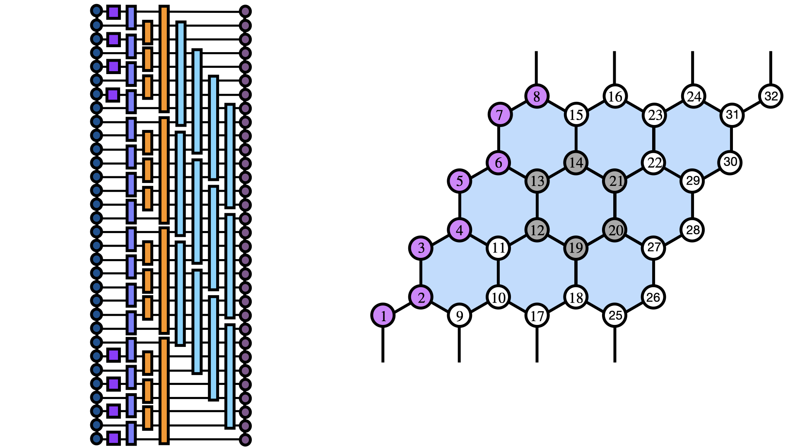

# Compilation.jl

Variational compilation of **Kitaev honeycomb ground states into shallow quantum
circuits**. A stored matrix-product-state (MPS) ground state of the Kitaev model
on a honeycomb cylinder — width 3 (*N* = 24) or width 4 (*N* = 32), with the
three-spin time-reversal-breaking κ term — is compiled into a finite-depth
circuit of **two-qubit Pauli rotations that preserves the model's conserved
sectors by construction**. Built on
[ITensors.jl](https://github.com/ITensor/ITensors.jl) and
[ITensorMPS.jl](https://github.com/ITensor/ITensorMPS.jl).



---

## Method

The driver `src/compilation/main.jl` runs four stages:

1. **Sector projection.** The initial product state is projected onto the
   target's conserved sectors: every plaquette flux ∏ₚ (1 + sₚWₚ)/2, the
   non-contractible loop (1 + sL)/2 on cylinders, and the edge-pairing
   stabilizers that pair the boundary Majorana zero modes. All signs are
   *measured from the target MPS*, never assumed.
2. **Gate layout.** One one-parameter rotation e^(−iθ σᵅσᵅ) per lattice bond,
   carrying the bond's Kitaev flavor. Every gate commutes with every Wₚ, the
   loop, and the pairing charges, so the circuit can never leave the projected
   sector — and because each site touches at most one bond per flavor, one
   block executes in **three two-qubit layers on hardware**.
3. **Analytic optimization.** Each angle's objective is B cos θ + A sin θ with
   coefficients read off cached left/right environments, so every update is the
   exact optimum θ\* = atan(A, B) and the overlap ⟨ψ_target|U|ψ₀⟩ is
   monotonically non-decreasing.
4. **Block growth.** Depth grows one identity-initialized block at a time,
   re-optimizing after each append — avoiding the local maxima that identity
   initialization hits at full depth.

**Why the projections matter.** Without them the reachable overlap is capped —
e.g. at 1/√2 on a cylinder whose loop sector is unprojected — because the
circuit conserves quantities the product state gets wrong. With all sectors
matched, no ceiling remains, and the in-sector circuit is Gaussian (each
rotation is quadratic in Majoranas): a block of *b* gates explores *b* of the
*m*(*m* − 1) parameters of the free-fermion manifold (*m* = *N*/2 modes).

| Geometry | Gates/block | Manifold dim | Reference result |
|---|---|---|---|
| Width 3, *N* = 24, κ = −0.2 | 33 | 132 | 3 blocks = 75% of manifold |
| Width 4, *N* = 32, κ = −0.3 | 44 | 240 | **F = 0.994** at 3 blocks (132 gates) |

---

## Repository layout

```
src/
  compilation/                     the compilation algorithm
    main.jl                        driver: projections, layout, optimization, growth
    validation.jl                  energy/⟨Wₚ⟩/⟨L⟩ validators for compiled circuits
    cached_environment.jl          layer-level environment helpers
    cached_environment_nonlocal.jl environment cache for non-adjacent, disjoint gate intervals
    compute_cost_function.jl       from-scratch fidelity (debug cross-check)
    data/                          target MPS files (.h5, git-ignored)
  helper/                          the reusable Kitaev-model library
    honeycomb_lattice.jl           C-style honeycomb bonds & wedges, dimension checks
    hamiltonian.jl                 cluster Hamiltonian MPO (Pauli & spin-1/2 conventions)
    blas_setup.jl                  per-platform BLAS backend (MKL on x86, OpenBLAS on ARM)
docs/                              compilation schematic; per-block gate patterns
```

---

## Requirements

Julia ≥ 1.10, environment pinned by the committed `Project.toml`/`Manifest.toml`:

```bash
julia --project=. -e 'using Pkg; Pkg.instantiate()'
```

Dependencies: `ITensors`, `ITensorMPS`, `HDF5`, `MKL`, `TimerOutputs` (plus
stdlibs `LinearAlgebra` and `Printf`).

---

## Quick start

```bash
cd src/compilation
julia --project=../.. main.jl
```

`const WIDTH = 3 | 4` near the top of `main.jl` selects the geometry, target
file, and the target's measured edge-pairing basis. Targets are expected in
`src/compilation/data/` as `cluster_n24_kappa-0.2_periodic.h5` /
`cluster_n32_kappa-0.3_periodic.h5` (keys `psi`, `E0`; produced by a
Pauli-convention DMRG run of the same Hamiltonian). Each run reports fidelity,
energy, per-plaquette ⟨Wₚ⟩, and ⟨L⟩ per sweep, cross-checks the target energy
against the stored `E0`, and saves the converged gate angles (reusable as a
warm start).

---

## Notes

- **Quality metrics are intensive.** A global many-body fidelity obeys
  F ∼ e^(−εN), so runs are judged by −ln F / N, energy density, and the sector
  observables — not by F alone (energy variance is available opt-in via
  `measure_variance`).
- **Topological sectors.** The cylinder's non-contractible loop cannot be
  flipped by any local update; the loop expectation identifies the sector a
  target converged into, and the loop projection matches the initial state to
  it exactly.
- **Operator conventions.** New targets use Pauli operators (`X`, `Y`, `Z`);
  `cluster_energy_mpo(...; pauli = false)` retains the spin-1/2 convention of
  legacy stored targets.
- The projection cascade verifies itself: each projected charge is re-measured
  on the projected state and any inconsistency raises an error before
  optimization starts.

---

## References

- A. Kitaev, *Anyons in an exactly solved model and beyond*,
  Ann. Phys. **321**, 2 (2006).
- S. R. White, *Density matrix formulation for quantum renormalization groups*,
  Phys. Rev. Lett. **69**, 2863 (1992).
- G. Evenbly and G. Vidal, *Algorithms for entanglement renormalization*,
  Phys. Rev. B **79**, 144108 (2009) — the cached-environment sweep pattern.

See `CITATION.cff` for how to cite this repository; licensed under the terms in
`LICENSE`.
